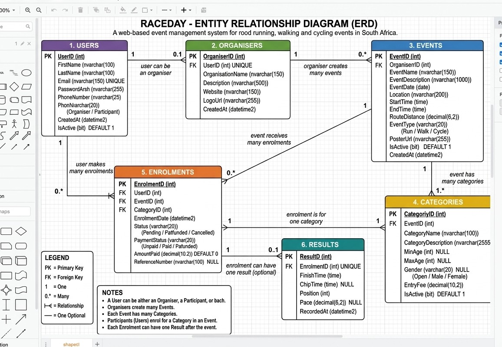
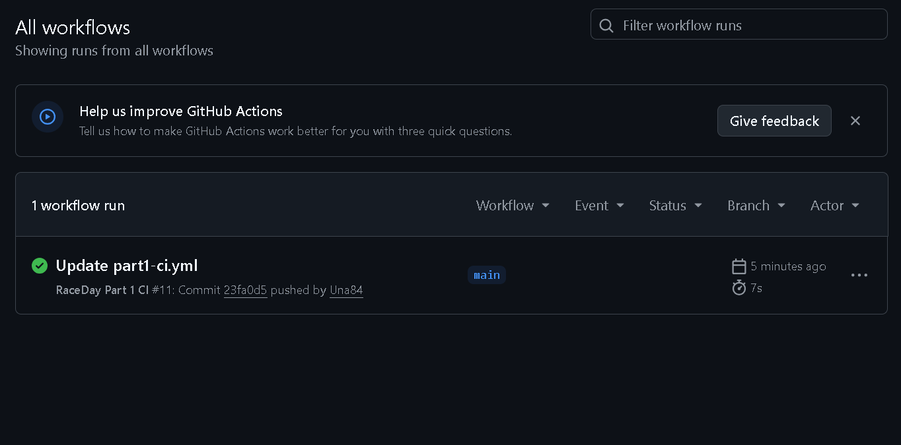

# RaceDay – Event Management System

## Project Overview

RaceDay is a full-stack web-based event management system designed for the South African road running, walking, and cycling community.

The system allows Event Organisers to create and manage sporting events, categories, participant enrolments and race results. Participants can create accounts, browse upcoming events, enter events, view their enrolments and track their personal race results.

The project is being developed progressively across three parts:

- **Part 1:** System Planning and Database Design
- **Part 2:** RESTful API Development and Testing
- **Part 3:** MVC Web Application, Azure Blob Storage and Docker Containerisation

---

# User Roles

## Organiser

Organisers are responsible for managing sporting events on the RaceDay platform.

Organisers can:

- Create events
- Edit events
- Delete or deactivate events
- Create event categories
- Edit categories
- Delete or deactivate categories
- View participant enrolments
- Manage enrolment status
- Capture participant results
- Edit results
- Delete incorrect results

## Participant

Participants use RaceDay to register and participate in events.

Participants can:

- Create an account
- Log into the system
- Manage their profile
- Browse upcoming events
- View event details
- View event categories
- Enrol in events
- Select an event category
- View their own enrolments
- View their personal race results

---

# Part 1 – System Planning and Database

Part 1 focuses on planning the RaceDay system before API development begins.

The following documents have been produced:

1. Entity Relationship Diagram (ERD)
2. API Endpoint Plan
3. SQL Server Database Script

---

## Database Entities

The RaceDay database contains the following entities:

1. Users
2. Organisers
3. Events
4. Categories
5. Enrolments
6. Results

The database relationships allow:

- Organisers to manage events
- Events to contain categories
- Participants to enrol in events
- Enrolments to have race results

---

## Entity Relationship Diagram

The Entity Relationship Diagram shows the structure of the RaceDay database and the relationships between the entities.



---

# Part 2 – RESTful API Development and Testing

Part 2 implements the backend RESTful Web API using **ASP.NET Core Web API (C#)** and **Entity Framework Core (Code-First Approach)** connected to a SQL Server database, following the endpoint plan produced in Part 1.

## Part 2 Learning Outcomes & Requirements
- Built a RESTful Web API using ASP.NET Core Web API in C# with Entity Framework Core Code-First approach matching the Part 1 ERD and SQL schema.
- Implemented user registration, login, and session-based authentication supporting Organiser and Participant roles with password hashing.
- Fully implemented all planned endpoints for Authentication, User Profile, Events, Categories, Event Enrolments, and Results.
- Integrated **Swagger / OpenAPI** for interactive endpoint testing directly through the browser.
- Developed comprehensive **Unit Tests** covering expected success and failure scenarios for authentication, event management, role rejection, and event enrolments.
- Configured automated **GitHub Actions CI/CD workflow** to build the solution and run all unit tests on every push.

---

# Project Documentation

The `/docs` folder contains the following project documentation:

| File | Description |
|---|---|
| `RaceDay_ERD.png` | Entity Relationship Diagram |
| `RaceDay_API_Endpoint_Plan.md` | RESTful API endpoint planning document |
| `RaceDay_Database.sql` | SQL Server database creation and sample data script |
| `ci-green-build.png` | Successful GitHub Actions CI/CD build screenshot |

---

# Database Setup

The RaceDay database was designed for Microsoft SQL Server and can be executed using SQL Server Management Studio (SSMS) or automatically generated via Entity Framework Core Code-First migrations in Part 2.

## Steps

1. Open **SQL Server Management Studio (SSMS)** or configure your `appsettings.json` connection string.
2. Create a new query.
3. Open `docs/RaceDay_Database.sql`.
4. Copy the complete SQL script into the query window if necessary.
5. Execute the complete script.
6. The script creates the `RaceDay` database.
7. The script creates all required tables and constraints.
8. Sample users, organisers, events, categories, enrolments and results are inserted.
9. Verification queries are included at the end of the script.

---

## Expected Seed Data

| Entity | Records |
|---|---:|
| Users | 4 |
| Organisers | 2 |
| Events | 3 |
| Categories | 7 |
| Enrolments | 4 |
| Results | 2 |

---

# API Planning & Implementation

The API Endpoint Plan defines the RESTful API that was successfully implemented in Part 2.

The implemented API covers:

- Authentication (Register & Login with password hashing)
- User profiles (View & Update)
- Events (Create, Read, Update, Delete/Deactivate)
- Categories (Create, Read, Update, Delete/Deactivate)
- Event Enrolments (Participant entry & Organiser management)
- Results (Capture, View, Update, Delete)

Role-based access is strictly enforced at the API level for Organisers and Participants.

The complete endpoint plan can be found in:

`docs/RaceDay_API_Endpoint_Plan.md`

---

# GitHub Actions / CI/CD & Unit Testing

GitHub Actions is used to automatically validate the repository structure, build the solution, and execute all unit tests for Part 2.

The workflows check that:
- The `/docs` folder, ERD, API endpoint plan, SQL database script, and README file exist.
- The solution successfully builds using the .NET SDK.
- All unit tests pass successfully.

## Successful CI/CD Build

The successful GitHub Actions build screenshot is shown below.



---

# Video Presentation

An unlisted YouTube video demonstrating Part 1 and Part 2 is provided below.

The video demonstrates:
- RaceDay system overview
- ERD and database relationships
- API endpoint plan and implementation
- SQL database script and Entity Framework setup
- Running the API and testing endpoints via Swagger UI
- Unit tests execution and role-based access verification

## YouTube Video

**Video Link:**  
https://youtu.be/wKNmxjomE90?si=r-a8bmEUBTud_WTi

---

# Repository Structure

```text
RaceDay/
├── .github/
│   └── workflows/
│       ├── part1-ci.yml
│       └── part2-ci.yml
│
├── docs/
│   ├── RaceDay_API_Endpoint_Plan.md
│   ├── RaceDay_Database.sql
│   ├── RaceDay_ERD.png.jpeg
│   └── ci-green-build.png.png
│
├── src/
│   ├── RaceDay.Api/
│   │   ├── Controllers/
│   │   │   ├── AuthController.cs
│   │   │   ├── CategoriesController.cs
│   │   │   ├── EnrolmentsController.cs
│   │   │   ├── EventsController.cs
│   │   │   ├── ResultsController.cs
│   │   │   └── UsersController.cs
│   │   ├── Dtos/
│   │   │   ├── AuthDtos.cs
│   │   │   ├── EventDtos.cs
│   │   │   └── ResultDtos.cs
│   │   ├── appsettings.json
│   │   ├── appsettings.Development.json
│   │   ├── Program.cs
│   │   └── RaceDay.Api.csproj
│   │
│   ├── RaceDay.Core/
│   │   ├── Data/
│   │   │   └── RaceDayDbContext.cs
│   │   ├── Entities/
│   │   │   ├── Category.cs
│   │   │   ├── Enrolment.cs
│   │   │   ├── Event.cs
│   │   │   ├── Organiser.cs
│   │   │   ├── Result.cs
│   │   │   └── User.cs
│   │   └── RaceDay.Core.csproj
│   │
│   └── RaceDay.Tests/
│       ├── Controllers/
│       │   ├── AuthControllerTests.cs
│       │   ├── EventsControllerTests.cs
│       │   └── EnrolmentsControllerTests.cs
│       └── RaceDay.Tests.csproj
│
├── RaceDay.sln
└── README.md
